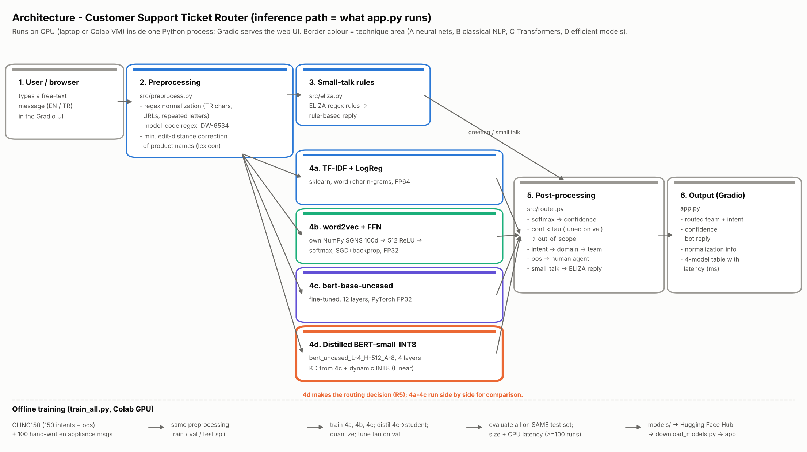

# SWE015 – Customer Support Ticket Router (Use Case 2)

An intelligent application that reads a free-text customer-support message (English or Turkish),
normalizes it, predicts one of *156 intents* with a confidence score and routes it to a team.
Low-confidence / out-of-scope messages go to a *human agent*; greetings and small talk get an
*ELIZA-style* reply. The routing decision is made by an *INT8-quantized, distilled BERT*; the
predictions of all four models are shown side by side.

| Rung | Model | Technique area |
|---|---|---|
| Classical baseline | TF-IDF (word + char n-grams) + logistic regression | B |
| Neural network | own word2vec (NumPy SGNS) → feedforward net, NumPy, SGD + backprop | A (+B) |
| Transformer | bert-base-uncased fine-tuned for intent classification | C |
| Quantized Transformer | bert_uncased_L-4_H-512_A-8 distilled from BERT-base → dynamic INT8 | D |

Preprocessing (area B): regex normalization (Turkish characters, URLs, repeated letters), regex
model-code extraction (DW-6534), minimum-edit-distance correction of misspelled product names.

## Quick start (run the app)

*Requirements:* Python 3.10 – 3.12, ~3 GB free disk, internet connection (first start only). No GPU needed.

*1. Get the code*

bash
git clone https://github.com/AMRO-44/swe015-ticket-router.git
cd swe015-ticket-router

*2. Create a virtual environment and install the packages*

macOS / Linux:
bash
python3 -m venv .venv
source .venv/bin/activate
pip install -r requirements.txt

Windows (PowerShell or cmd):
bat
python -m venv .venv
.venv\Scripts\activate
pip install -r requirements.txt

*3. Run the app (single command)*

bash
python app.py

Then open *http://127.0.0.1:7860* in your browser and type a message, e.g.
my dishwaser is leaking water everywhere or bulaşık makinem su boşaltmıyor, model DW-6534.

* On the first start the app automatically downloads the trained weights (≈ 0.6 GB) from the public
  Hugging Face repo **https://huggingface.co/AMRO-44/swe015-ticket-router** into models/
  (repo id set in src/config.py → HF_REPO_ID). Later starts are offline and fast.
* python app.py --share creates a temporary public link (useful on Google Colab).
* Manual download only: python scripts/download_models.py.

*Run it on Google Colab instead (no local install):* new notebook, then

python
!git clone https://github.com/AMRO-44/swe015-ticket-router.git
%cd swe015-ticket-router
!pip install -q -r requirements.txt
!python app.py --share

*Troubleshooting*

| Problem | Fix |
|---|---|
| [download] failed | check your internet connection; the weights repo must be reachable at the link above |
| "No trained models found" | run python scripts/download_models.py, or train them yourself (next section) |
| python not found (macOS/Linux) | use python3 |
| port 7860 busy | python app.py --port 7861 |

## Reproduce all results

All numbers in results/results.json, results/results_table.md and the presentation come from:

bash
python train_all.py               # all models; GPU recommended (≈30-45 min on a Colab T4)
python train_all.py --skip-transformers   # only baseline + word2vec/FFN (CPU, ≈3 min)

or open notebooks/colab_train.ipynb in Google Colab (GPU runtime). train_all.py

1. trains the baseline and the word2vec + FFN, and evaluates them;
2. fine-tunes BERT-base, quantizes it (extra row), distils it into BERT-small, quantizes the student;
3. evaluates every model on the *same held-out test split* (CLINC150 test + oos test + our appliance test);
4. measures model size on disk and *CPU latency for one message, mean of 200 runs* (hardware is recorded);
5. regenerates docs/architecture.png, results/results_chart.png and docs/presentation.pptx/.pdf.

Afterwards upload the weights once: huggingface-cli login then
HF_REPO_ID=AMRO-44/swe015-ticket-router python scripts/upload_to_hub.py.

Tests (edit distance, regex, ELIZA, threshold metrics, numerical gradient check of the FFN backprop):
python -m pytest -q

## Metrics

* *In-scope accuracy* – accuracy on the 4,525 in-scope test messages
* *Out-of-scope recall* – share of the 1,000 out-of-scope test messages sent to the human agent
* *Overall accuracy* – all 5,525 test messages (out-of-scope counts as a class)

A message is out-of-scope if the predicted class is oos *or* the max probability is below a threshold
τ; τ is tuned per model on the validation split only.

## Repository layout

app.py                     Gradio application (runs the INT8 student)
train_all.py               trains + evaluates everything, writes results/ and docs/
src/config.py              paths, hyper-parameters, HF repo id, intent -> team table
src/data.py                CLINC150 + appliance data, splits
src/preprocess.py          regex normalization, model codes, edit-distance correction   (B)
src/eliza.py               ELIZA small-talk rules                                       (B)
src/baseline.py            tf-idf + logistic regression                                 (B)
src/word2vec_np.py         skip-gram negative sampling in NumPy                         (B/A)
src/ffn_np.py              feedforward network + backprop + SGD in NumPy                (A)
src/transformer.py         BERT fine-tuning, distillation, INT8 quantization            (C/D)
src/benchmark.py           size + latency measurement                                   (D)
src/evaluate.py            thresholds and metrics
src/router.py              inference pipeline used by the app
scripts/                   download/upload weights, figures, slides
data/                      CLINC150 (CC BY 3.0) + data/appliance_intents.csv
notebooks/colab_train.ipynb

## Data & licences

* CLINC150 – S. Larson et al., *An Evaluation Dataset for Intent Classification and Out-of-Scope
  Prediction*, EMNLP 2019, https://github.com/clinc/oos-eval (CC BY 3.0).
* 100 hand-written appliance support messages (EN + TR) in data/appliance_intents.csv.
* Pretrained checkpoints: google-bert/bert-base-uncased, google/bert_uncased_L-4_H-512_A-8
  (Hugging Face Hub, Apache-2.0).

## AI usage

AI assistants were used for parts of the code and slides; see the AI-usage slide in the presentation.
